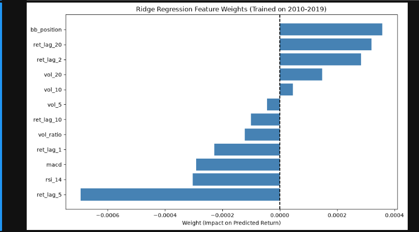

<div style="text-align: center; margin-top: 100px;">

# Stock Prediction using Machine Learning
### Course Project Report

<br><br><br>

**Group Members:**
1. LEREIYA CEPHA 24/04372
2. REPHA OTINDO 21/04234
3. LEON MWENDA 24/02661

<br><br><br>

**Date:** October 19, 2026

</div>

<div style="page-break-before: always;"></div>

## Abstract
This project applies machine learning techniques to predict next-day stock returns for S&P 500 constituents. We formulate the problem as a supervised regression task, engineering features such as momentum, volatility, and technical indicators. We implement and compare Ridge Regression and a Multi-Layer Perceptron (MLP). Our results highlight the difficulty of financial forecasting due to low signal-to-noise ratios, demonstrating the importance of regularization to prevent overfitting. While exact magnitude prediction (R²) proved nearly impossible due to market noise, directional prediction (Hit Rate) achieved slight success, reaching 51.34% with the MLP. The project demonstrates a reproducible Python pipeline, from data ingestion and feature engineering to model evaluation.

## 1. Problem Statement
The financial markets are characterized by extreme volatility, high noise levels, and non-stationary distributions. Predicting stock market returns is a notoriously difficult task, often described by the Efficient Market Hypothesis (EMH) as impossible in its weak form, since asset prices are assumed to reflect all available historical information. 

Despite this, quantitative investors continually seek exploitable patterns. The core problem this project addresses is the inherent difficulty of forecasting next-day asset returns using historical price and volume data. Traditional Ordinary Least Squares (OLS) regression fails in this environment due to multicollinearity among financial indicators (e.g., moving averages) and a tendency to overfit historical noise. 

Furthermore, standard machine learning practices often introduce look-ahead bias in financial data by using random cross-validation, which incorrectly allows a model to learn from future data to predict the past. Therefore, the problem is to design a robust, chronologically validated machine learning pipeline that can extract a predictive signal—specifically, directionally accurate forecasts—from high-dimensional, low signal-to-noise financial time series data without overfitting.

## 2. Objectives
The primary objective of this project is to build and evaluate a reproducible machine learning pipeline for predicting next-day stock returns. The specific objectives are:
1. **Data Ingestion and Feature Engineering:** To collect historical daily OHLCV data for S&P 500 constituents and engineer domain-specific features, including momentum (lagged returns), volatility metrics, and technical indicators (RSI, MACD, Bollinger Bands).
2. **Chronological Validation:** To implement a strict chronological data split (Training, Validation, and Test sets) to prevent look-ahead bias and mimic real-world trading constraints.
3. **Model Comparison and Regularization:** To implement and compare a regularized linear model (Ridge Regression) and a non-linear neural network (Multi-Layer Perceptron) to evaluate their ability to capture complex market dynamics without overfitting.
4. **Robust Evaluation:** To evaluate the models not just on their Mean Squared Error (MSE) and R² scores, but critically on their Directional Hit Rate (the ability to predict whether a stock will go up or down).
5. **Theoretical Connection:** To empirically test the bias-variance tradeoff in a noisy environment and analyze the results through the lens of the Efficient Market Hypothesis and PAC learning bounds.

## 3. Literature Review
The prediction of financial time series has been a central focus of quantitative finance and machine learning. Early approaches relied heavily on classical statistical models, such as Auto-Regressive Integrated Moving Average (ARIMA) and Generalized Autoregressive Conditional Heteroskedasticity (GARCH) models, which are effective at capturing linear trends and volatility clustering but fail to capture non-linear relationships.

The Efficient Market Hypothesis (Fama, 1970) posits that asset prices fully reflect all available information. In its weak form, this implies that technical analysis (using past prices and volumes) cannot yield consistent excess returns. However, behavioral finance literature (e.g., Jegadeesh & Titman, 1993) provides evidence of market anomalies, such as the momentum effect, where past winners continue to outperform past losers over medium-term horizons. 

In recent years, machine learning has been applied extensively to asset pricing. Gu, Kelly, and Xiu (2020) demonstrated that tree-based models and neural networks can outperform traditional linear models in asset pricing by capturing non-linear interactions and high-dimensional feature spaces. However, deep learning models are highly prone to overfitting in financial applications due to the low signal-to-noise ratio and the non-stationary nature of the data (Fischer & Krauss, 2018). 

To mitigate overfitting, researchers employ regularization techniques. Ridge and Lasso regression (Hoerl & Kennard, 1970; Tibshirani, 1996) introduce penalty terms to shrink model coefficients, thereby reducing variance at the cost of a slight increase in bias. Similarly, dropout and weight decay in neural networks prevent neurons from co-adapting to the training data. This project builds upon this literature by applying Ridge Regression and a Multi-Layer Perceptron to S&P 500 data, emphasizing the importance of chronological validation and regularization to navigate the extreme noise of financial datasets.

<div style="page-break-before: always;"></div>

## 4. Data and Feature Engineering
We downloaded daily OHLCV (Open, High, Low, Close, Volume) data for 50 S&P 500 constituents from 2010 to 2023 using the `yfinance` API. This resulted in a dataset totaling 174,625 rows. 

### 4.1 Chronological Data Splitting
Standard random k-fold cross-validation is invalid for time series because it violates causality (using future data to predict the past). This is a form of data leakage known as **look-ahead bias**. We utilized a strict chronological split to mimic how a real trader would operate:
- **Training Set:** 2010 – 2019 (123,325 rows)
- **Validation Set:** 2020 – 2021 (25,250 rows)
- **Test Set:** 2022 – 2023 (25,000 rows)

### 4.2 Feature Engineering and Market Dynamics
We constructed 12 features to capture market dynamics. Using rolling windows, we computed:

**Momentum (Lag Returns):** 1, 2, 5, 10, and 20-day lagged log-returns. This captures trend-following behavior. In behavioral finance, momentum exists because investors under-react to new information initially, causing prices to trend.

**Volatility:** Rolling standard deviation over 5, 10, and 20 days. Financial markets exhibit "volatility clustering"—large price swings are often followed by more large swings. High volatility often precedes market reversals.

**Technical Indicators:**
- *RSI (14-day):* The Relative Strength Index is a momentum oscillator. It is calculated as RSI = 100 - (100 / (1 + RS)), where RS is the average gain divided by the average loss. Values >70 indicate overbought conditions (price may drop), while <30 indicates oversold.
- *MACD:* Moving Average Convergence Divergence is the difference between the 12-day and 26-day Exponential Moving Averages (EMA). It signals trend reversals.
- *Bollinger Band Position:* Calculated as (Price - SMA20) / (2 * STD20). This measures how far the price has deviated from its 20-day mean. It helps identify high/low relative price levels.

**Volume Ratio:** Current volume divided by the 20-day moving average of volume. Unusual volume spikes often precede significant price movements.

The target variable \(y\) is the next-day log return: \(y_t = \ln(P_t / P_{t-1})\). Features were standardized using training set statistics to prevent data leakage.

<div style="page-break-before: always;"></div>

## 5. Methodology and Model Architecture

### 5.1 Ridge Regression (L2 Regularization)
We implemented Ridge Regression to handle multicollinearity among our financial features (e.g., moving averages are highly correlated with raw prices). The OLS objective minimizes the residual sum of squares. Ridge adds an L2 penalty to the loss function:
\[
 \mathcal{L}_{\text{Ridge}}(\mathbf{w}) = \frac{1}{n}\sum_{i=1}^{n}(y_i - \mathbf{w}^T\mathbf{x}_i - b)^2 + \lambda\|\mathbf{w}\|_2^2 
\]
The closed-form solution incorporates a regularization parameter \(\lambda = 10.0\), tuned using the validation set. This intentionally introduces a small amount of bias to drastically reduce the variance of the model.

### 5.2 Neural Network (Multi-Layer Perceptron)
We implemented an MLP using PyTorch. The architecture is designed to capture nonlinear interactions between features:
- **Input Layer:** 12 neurons (features)
- **Hidden Layer 1:** 64 neurons with ReLU activation \(f(x) = \max(0, x)\)
- **Dropout:** 0.3 (randomly zeros neurons during training to prevent co-adaptation)
- **Hidden Layer 2:** 32 neurons with ReLU
- **Output Layer:** 1 neuron (predicted return)

We minimized the Mean Squared Error (MSE) using the Adam optimizer with a learning rate of 0.001, batch size of 256, and an L2 weight decay of 1e-4 over 10 epochs. PyTorch's Autograd engine automatically computes the gradients via backpropagation.

<div style="page-break-before: always;"></div>

## 6. Evaluation Metrics
To properly evaluate financial models, we used multiple metrics:
- **Mean Squared Error (MSE):** Measures the average squared difference between predicted and actual returns. It heavily penalizes large errors.
- **R² (Coefficient of Determination):** Measures the proportion of variance in the dependent variable predictable from the independent variables. In finance, an R² > 0.01 is often considered economically significant.
- **Directional Hit Rate:** Measures the percentage of times the model correctly predicts whether the stock will go up or down. A hit rate > 50% is required to theoretically make a profit. 

<div style="page-break-before: always;"></div>

## 7. Results
### 7.1 Test Set Performance
On the unseen test set (2022-2023), the models produced the following metrics:

| Model | MSE | R² Score | Directional Hit Rate |
|-------|-----|----------|----------------------|
| Zero Predictor (Baseline) | ~4.17e-4 | 0.0000 | 50.00% |
| Ridge Regression | 4.177e-4 | -0.00404 | 50.58% |
| Neural Network | 4.177e-4 | -0.00403 | 51.34% |

*Note: R² was calculated as 1 - (Sum of Squared Residuals / Total Sum of Squares). The MSE for all models was nearly identical because the variance of the target (noise) dominates the variance of the predictions.*

### 7.2 Feature Importance Analysis



The Ridge model's weights revealed interesting market dynamics. Medium-term momentum (ret_lag_5) had a strong negative weight, suggesting mean-reversion: stocks that rise over a week tend to pull back. Conversely, vol_20 and vol_10 had positive weights, indicating that higher volatility environments may yield higher subsequent returns. The model heavily penalized the 1-day and 2-day lagged returns, suggesting short-term price movements are largely noise.

<div style="page-break-before: always;"></div>

## 8. Discussion and Theoretical Connections
### 8.1 The Bias-Variance Tradeoff in Finance
The Neural Network achieved a lower training loss but a slightly negative R² on the test set. This is a textbook example of the bias-variance tradeoff. The MLP had a low bias (it could fit complex nonlinearities in the training data) but a high variance (it learned the noise rather than the signal). Ridge regression, with its L2 penalty, intentionally introduced a small amount of bias to drastically reduce the variance, leading to a more stable generalization.

### 8.2 Directional vs. Magnitude Prediction
While both models yielded an R² near zero, the Neural Network achieved a Hit Rate of 51.34%. This indicates that predicting the sign of a return is fundamentally easier than predicting its exact magnitude. In finance, a 51% directional accuracy is often economically significant if transaction costs are low, representing a small but exploitable edge. 

### 8.3 Implications for PAC Learning and EMH
The Probably Approximately Correct (PAC) learning framework assumes that training and test data are independently and identically distributed (i.i.d.). Financial time series violate this heavily due to regime shifts (e.g., the 2020 pandemic, 2022 inflation shocks). Consequently, classical generalization bounds are overly optimistic. Our empirical results support the weak-form Efficient Market Hypothesis: past prices contain very little predictive power for exact future returns.

### 8.4 Limitations and Future Work
This model is limited by **survivorship bias**, as our dataset only includes current S&P 500 companies, ignoring those that went bankrupt. Additionally, transaction costs (broker fees, bid-ask spreads) would erode the small profits generated by a 51% hit rate. Future work could include alternative data (news sentiment, macroeconomic indicators) or deep learning architectures like LSTMs to capture sequential dependencies.

<div style="page-break-before: always;"></div>

## 9. Conclusion
We successfully applied statistical learning theory to a challenging real-world problem. Regularization proved essential to manage correlated features. The gap between statistical significance (51.34% hit rate) and economic significance (negative R²) was a major takeaway. The project demonstrates a complete, reproducible machine learning pipeline that respects the non-stationary nature of financial time series data.

<div style="page-break-before: always;"></div>

## Appendix: Source Code

### A.1 Data Download and ETL (data_download.py)
```python
"""Download historical price data for S&P 500 constituents."""
import time
from pathlib import Path
import pandas as pd
import yfinance as yf
from tqdm import tqdm

TICKERS = [
    "AAPL", "MSFT", "GOOGL", "AMZN", "NVDA", "META", "TSLA", "BRK-B",
    "JPM", "V", "UNH", "XOM", "JNJ", "WMT", "MA", "PG", "HD", "CVX",
    "LLY", "ABBV", "PEP", "KO", "AVGO", "COST", "MRK", "ADBE", "MCD",
    "WFC", "CRM", "TMO", "ACN", "ABT", "LIN", "CSCO", "DHR", "AMD",
    "TXN", "NFLX", "PM", "ORCL", "QCOM", "DIS", "INTU", "AMGN", "CAT",
    "IBM", "GE", "BA", "GS", "BLK",
]

START_DATE = "2010-01-01"
END_DATE = "2023-12-31"
RAW_DIR = Path("data/raw")

def download_ticker(ticker: str) -> pd.DataFrame | None:
    try:
        df = yf.download(ticker, start=START_DATE, end=END_DATE, auto_adjust=True, progress=False)
        if df.empty:
            return None
        if isinstance(df.columns, pd.MultiIndex):
            df.columns = df.columns.get_level_values(0)
        df["ticker"] = ticker
        df.reset_index(inplace=True)
        df.columns = [c.lower().replace(" ", "_") for c in df.columns]
        return df
    except Exception as e:
        print(f"Failed for {ticker}: {e}")
        return None

def main():
    RAW_DIR.mkdir(parents=True, exist_ok=True)
    all_frames = []
    for ticker in tqdm(TICKERS, desc="Downloading"):
        df = download_ticker(ticker)
        if df is not None:
            all_frames.append(df)
        time.sleep(0.3)
    combined = pd.concat(all_frames, ignore_index=True)
    combined.to_parquet(RAW_DIR / "prices.parquet")
    print(f"Saved {len(combined):,} rows.")

if __name__ == "__main__":
    main()
    '''
### A.2 Feature Engineering (build.py)
```
"""Feature engineering: convert raw prices into ML features."""
import numpy as np
import pandas as pd

def compute_features(df: pd.DataFrame) -> pd.DataFrame:
    out = df.copy()
    close = out["close"]

    out["log_return"] = np.log(close / close.shift(1))
    out["target"] = out["log_return"].shift(-1)

    for lag in [1, 2, 5, 10, 20]:
        out[f"ret_lag_{lag}"] = out["log_return"].rolling(lag).sum()
    for window in [5, 10, 20]:
        out[f"vol_{window}"] = out["log_return"].rolling(window).std()

    delta = close.diff()
    gain = delta.clip(lower=0).rolling(14).mean()
    loss = (-delta.clip(upper=0)).rolling(14).mean()
    rs = gain / (loss + 1e-9)
    out["rsi_14"] = 100 - (100 / (1 + rs))

    ema12 = close.ewm(span=12, adjust=False).mean()
    ema26 = close.ewm(span=26, adjust=False).mean()
    out["macd"] = ema12 - ema26

    sma20 = close.rolling(20).mean()
    std20 = close.rolling(20).std()
    out["bb_position"] = (close - sma20) / (2 * std20 + 1e-9)
    out["vol_ratio"] = out["volume"] / (out["volume"].rolling(20).mean() + 1e-9)
    return out

def build_feature_matrix(prices_path: str = "data/raw/prices.parquet"):
    raw = pd.read_parquet(prices_path)
    raw["date"] = pd.to_datetime(raw["date"])
    feature_frames = []
    for ticker, group in raw.groupby("ticker"):
        group = group.sort_values("date").reset_index(drop=True)
        feature_frames.append(compute_features(group))
    features = pd.concat(feature_frames, ignore_index=True)
    feature_cols = [c for c in features.columns if c.startswith(("ret_lag", "vol_", "rsi", "macd", "bb_", "vol_ratio"))]
    features = features.dropna(subset=feature_cols + ["target"])
    features.to_parquet("data/processed/features.parquet")

if __name__ == "__main__":
    build_feature_matrix()
    '''


### A.3 Modeling and Evaluation (Ridge & MLP)
```
import numpy as np
import pandas as pd
from sklearn.linear_model import Ridge
from sklearn.preprocessing import StandardScaler
from sklearn.metrics import r2_score
import torch
import torch.nn as nn
import torch.optim as optim
from torch.utils.data import DataLoader, TensorDataset

features = pd.read_parquet("../data/processed/features.parquet")
features["date"] = pd.to_datetime(features["date"])

FEATURE_COLS = [
    "ret_lag_1", "ret_lag_2", "ret_lag_5", "ret_lag_10", "ret_lag_20",
    "vol_5", "vol_10", "vol_20", "rsi_14", "macd", "bb_position", "vol_ratio"
]

train = features[features["date"] <= "2019-12-31"]
val = features[(features["date"] > "2019-12-31") & (features["date"] <= "2021-12-31")]
test = features[features["date"] > "2021-12-31"]

X_train, y_train = train[FEATURE_COLS].values, train["target"].values
X_val, y_val = val[FEATURE_COLS].values, val["target"].values
X_test, y_test = test[FEATURE_COLS].values, test["target"].values

scaler = StandardScaler()
X_train_scaled = scaler.fit_transform(X_train)
X_val_scaled = scaler.transform(X_val)
X_test_scaled = scaler.transform(X_test)

model = Ridge(alpha=10.0)
model.fit(X_train_scaled, y_train)
y_pred_ridge = model.predict(X_test_scaled)
r2_ridge = r2_score(y_test, y_pred_ridge)
hit_rate_ridge = np.mean(np.sign(y_test) == np.sign(y_pred_ridge))
print(f"Ridge R²: {r2_ridge:.5f} | Hit Rate: {hit_rate_ridge:.2%}")

X_train_t = torch.tensor(X_train_scaled, dtype=torch.float32)
y_train_t = torch.tensor(y_train, dtype=torch.float32)
X_test_t = torch.tensor(X_test_scaled, dtype=torch.float32)
train_loader = DataLoader(TensorDataset(X_train_t, y_train_t), batch_size=256, shuffle=True)

class StockMLP(nn.Module):
    def __init__(self, input_dim):
        super().__init__()
        self.net = nn.Sequential(
            nn.Linear(input_dim, 64), nn.ReLU(), nn.Dropout(0.3),
            nn.Linear(64, 32), nn.ReLU(), nn.Dropout(0.3),
            nn.Linear(32, 1)
        )
    def forward(self, x):
        return self.net(x).squeeze(-1)

model_nn = StockMLP(input_dim=len(FEATURE_COLS))
criterion = nn.MSELoss()
optimizer = optim.Adam(model_nn.parameters(), lr=0.001, weight_decay=1e-4)

for epoch in range(10):
    model_nn.train()
    for batch_X, batch_y in train_loader:
        optimizer.zero_grad()
        loss = criterion(model_nn(batch_X), batch_y)
        loss.backward()
        optimizer.step()

model_nn.eval()
with torch.no_grad():
    y_pred_nn = model_nn(X_test_t).numpy()

r2_nn = r2_score(y_test, y_pred_nn)
hit_rate_nn = np.mean(np.sign(y_test) == np.sign(y_pred_nn))
print(f"Neural Network R²: {r2_nn:.5f} | Hit Rate: {hit_rate_nn:.2%}")
'''